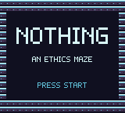
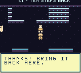
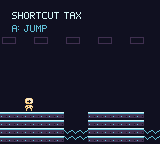
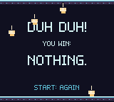

# NOTHING

### One prompt. A real cartridge. You win NOTHING.

I asked my coding camel to build an ethics maze for my ModRetro Chromatic.
Help someone. Respect their answer. Own your mistakes. Take the shortcut and
you owe the game a platformer detour. You **must beat it** to get back out.

Your reward for finishing? Raining pixel middle fingers and **DUH DUH — YOU WIN: NOTHING.**

Because doing the decent thing doesn't always come with a prize. lol 🐫

## Play it

**[Download NOTHING.gbc](https://github.com/starbrite-j/nothing/raw/refs/heads/main/dist/NOTHING.gbc)**

This is a native **Game Boy Color ROM**, not a browser mockup. Open it in a
GBC-compatible emulator, or use your compatible homebrew cartridge's normal
loading procedure. It was flashed to a ModRetro Chromatic and beaten on the
actual handheld by Jess. It requires color hardware; original monochrome Game
Boy support is not included.

| Control | Action |
| --- | --- |
| D-pad | Move; select an answer |
| A | Talk, interact, confirm; jump in the detour |
| Start | Begin/continue; checkpoint menu; replay prompt at the ending |

Progress saves at checkpoints, including unfinished detours. Back up any
existing cartridge save before replacing a game. The ending includes rude
pixel gestures, as advertised.

## What “one prompt” means

One original game-design prompt from Jess supplied the maze, ethical yes/no
choices, nested arcade punishments, creative freedom, and the ridiculous ending.
The follow-up **“must beat it”** settled how detours work. Codex, nicknamed
**Camelcamel**, handled the implementation, art, debugging, emulator checks,
and cartridge deployment. Jess played the finished cartridge and confirmed the win.

This is the result of that prompt and the work it set in motion. There were
iterations and real bugs to fix. We're proud of the result, not pretending those
steps didn't happen.

## What's in this version

- Three maze rooms about helping, consent, and taking responsibility.
- Actions that matter: agreeing to fetch a map doesn't magically return it;
  admitting a broken sign doesn't fix it.
- **Shortcut Tax**, an original three-jump platformer you must complete after a
  wrong answer. Winning returns you to the unresolved question.
- Checkpoint saves, retries, an ending that survives a restart, and an explicit
  fresh-game choice.
- Dark metallic rooms, neon accents, and the promised falling hands.

This first release has one reusable arcade detour. The other game types in the
original idea are future possibilities. These are authored situations with
authored answers, not a universal ethics score.

## Make it yours

The editable GB Studio project is included: open `project.gbsproj`.
Scene events are the game logic; `project/` and `assets/` are the source.
No AI service, API key, or account is needed to play the ROM.

- [Build instructions](BUILDING.md)
- [Testing and known limits](TESTING.md)
- [Credits and dependency licenses](CREDITS.md)
- [Contributing](CONTRIBUTING.md)

Original game code and artwork are **MIT licensed**. Included upstream assets
and compiled runtime components retain the notices listed in [CREDITS.md](CREDITS.md).
Fork it. Change the questions. Make a worse punishment. Give somebody NOTHING.

Concept, direction, and hardware playtest: **Jess / [starbrite-j](https://github.com/starbrite-j)**.
Implementation with **Codex / Camelcamel**. An independent homebrew project;
not an official OpenAI or ModRetro release.
